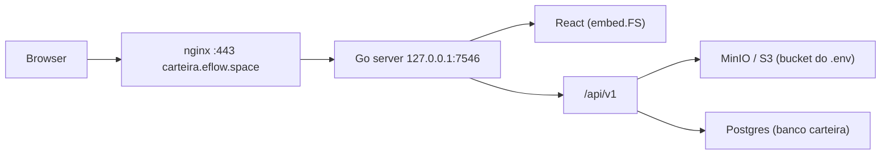

# Arquitetura



Um único binário Go serve tudo: rotas `/api/*` vão para a API e qualquer outra rota devolve o build do React (com fallback para `index.html`, por causa do React Router).

## Pastas

```
backend/
  cmd/server/main.go        boot: config, Postgres + migrations, MinIO, rotas, shutdown
  internal/config           leitura do .env
  internal/db               pool pgx e migrations SQL embutidas (aplicadas no boot)
  internal/db/migrations    0001_init.sql, ... (nova mudança de schema = novo arquivo)
  internal/storage          cliente MinIO (Put, Remove, Ping)
  internal/httpx            JSON/erros, logger
  internal/auth             register/login/logout, cookie carteira_session, middleware
  internal/documents        upload, versões, verify, receipt, expire, soft-delete
  internal/collections      coleções N:N
  internal/shares           links públicos + token
  internal/audit            trilha de eventos
  web/                      embed do frontend (backend/web/dist, gerado pelo Vite)
frontend/
  src/api/client.ts         chamadas reais à API (credentials: include)
  src/pages/                uma página por tela
  src/components/ui.tsx     badge de estado, hash, formatação
  src/auth.tsx              guard de sessão
```

## Autenticação e titular (RF-01/02)

Sessão própria via cookie HttpOnly `carteira_session` (`internal/auth`). O middleware resolve o usuário e injeta o `owner_id` (UUID) nas rotas privadas. Sem sessão → `401`. Documento de outro titular → `403`. Público sem login: `GET /health`, `GET /public/shares/{token}`, `GET /public/documents/{id}/integrity` (+ `/file`), register/login/logout. SPA pública: `/v/:token` (share) e `/i/:id` (recibo).

Atores e casos de uso acadêmicos: [ATORES.md](./ATORES.md), [CASOS_DE_USO.md](./CASOS_DE_USO.md).

## Fluxo de upload (RF-03/04/08/09)

1. `POST /api/v1/documents` com multipart. O corpo é limitado a `MAX_UPLOAD_MB`.
2. Os metadados são validados: `type` entre os tipos predefinidos e `origin` obrigatório.
3. O MIME real é detectado pelos primeiros 512 bytes; só PDF, JPEG e PNG passam (a extensão do arquivo é ignorada).
4. O SHA-256 é calculado sobre os bytes exatos recebidos.
5. O objeto vai para o MinIO em `documents/{owner}/{docID}/v1/{sha256}.{ext}`.
6. Uma transação grava `documents`, `document_versions` e `integrity_records`. Se a transação falhar, o objeto é removido do bucket.

## Modelo de dados

| Tabela | Papel |
|---|---|
| `users` / `sessions` | titular e sessão (RF-01/02) |
| `documents` | metadados, `owner_id`, `status` (`active`, `replaced`, `revoked`, `expired`), `deleted_at` |
| `document_versions` | cada arquivo enviado; versões nunca são alteradas no lugar (RF-14) |
| `integrity_records` | algoritmo + hash por versão |
| `verifications` | evidências de verificação (RF-10/11) |
| `collections` / `collection_documents` | coleções do titular (RF-06) |
| `shares` | tokens de compartilhamento (RF-18/19/20) |
| `audit_events` | trilha de auditoria (RF-21) |

Transições de estado: revogação com motivo (RF-15), expiração automática/lazy (RF-16), substituição de versão (RF-14), exclusão lógica com revogação de shares (RF-22).
