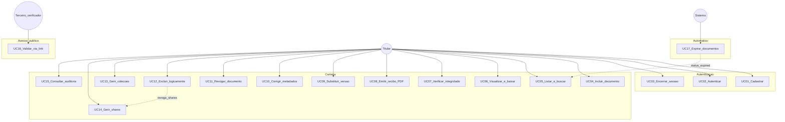

# Casos de uso

**Atores:** [ATORES.md](./ATORES.md)  
**API:** [API.md](./API.md)

## 1. Diagrama de casos de uso

## 2. Catálogo (UC ↔ RF ↔ rota)

| UC | Nome | Ator | RF | Rota / superfície principal |
|---|---|---|---|---|
| UC01 | Cadastrar titular | Titular | 01 | `POST /auth/register` |
| UC02 | Autenticar | Titular | 01/02 | `POST /auth/login` |
| UC03 | Encerrar sessão | Titular | 02 | `POST /auth/logout` |
| UC04 | Incluir documento | Titular | 03/04/05/08/09/16 | `POST /documents` |
| UC05 | Listar e buscar | Titular | 05/06/07 | `GET /documents` |
| UC06 | Visualizar e baixar | Titular | 07 | `GET /documents/{id}`, `…/file` |
| UC07 | Verificar integridade | Titular | 10/11/23 | `POST …/verify`, `GET …/verifications` |
| UC08 | Emitir recibo PDF | Titular | 12 | `GET …/receipt` |
| UC09 | Substituir versão | Titular | 14/13 | `POST …/versions` |
| UC10 | Corrigir metadados | Titular | 17 | `PATCH /documents/{id}` |
| UC11 | Revogar documento | Titular | 13/15 | `POST …/revoke` |
| UC12 | Excluir logicamente | Titular | 22 | `DELETE /documents/{id}` |
| UC13 | Gerir coleções | Titular | 06 | `/collections` |
| UC14 | Gerir compartilhamentos | Titular | 18/19 | `…/shares` |
| UC15 | Consultar auditoria | Titular | 21 | `GET /audit` |
| UC16 | Validar via link | Terceiro | 20/23 | `GET /public/shares/{token}` |
| UC17 | Expirar documentos | Sistema | 16 | job + lazy list/get |

## 3. Especificações (principais)

### UC01 — Cadastrar titular

- **Pré:** e-mail ainda não cadastrado; senha ≥ 8 caracteres.
- **Pós:** usuário criado; cookie `carteira_session` emitido.
- **Básico:** Titular envia e-mail/senha/nome → API valida → grava `users` + sessão → `201`.
- **Alternativo:** e-mail duplicado → `409`; senha curta / e-mail inválido → `422`.

### UC02 — Autenticar

- **Pré:** conta existente.
- **Pós:** sessão válida (TTL 7 dias).
- **Básico:** e-mail/senha corretos → cookie → `200` + perfil.
- **Alternativo:** credenciais inválidas → `401` genérico (sem vazar qual campo falhou).

### UC03 — Encerrar sessão

- **Pré:** cookie presente (ou não).
- **Pós:** sessão removida; cookie limpo; `204`.
- **Básico:** `POST /auth/logout` → delete por hash do token.

### UC04 — Incluir documento

- **Pré:** sessão válida; arquivo PDF/JPEG/PNG ≤ `MAX_UPLOAD_MB`; `type` e `origin` válidos.
- **Pós:** `documents` + `document_versions` + `integrity_records`; objeto no MinIO; hash SHA-256 = conteúdo enviado.
- **Básico:** multipart → validação MIME/metadados → hash → Put MinIO → commit DB → `201`.
- **Alternativo:** MIME inválido → `415`; arquivo grande → `413`; metadados → `422`; falha DB → remove objeto órfão.

### UC05 — Listar e buscar

- **Pré:** sessão válida.
- **Pós:** lista do titular com `deleted_at IS NULL` (após lazy expire se aplicável).
- **Básico:** filtros `q` / `type` / `status` / `tag` / `collection`.
- **Alternativo:** sem resultados → `items: []`.

### UC06 — Visualizar e baixar

- **Pré:** documento do titular, não excluído.
- **Pós:** metadados ou stream do arquivo da versão atual.
- **Alternativo:** outro dono → `403`; inexistente/excluído → `404`.

### UC07 — Verificar integridade

- **Pré:** documento acessível ao titular.
- **Pós:** evidência em `verifications` (match / mismatch); UI reforça RF-23.
- **Básico:** relê objeto no MinIO → recalcula SHA-256 → compara com `integrity_records`.
- **Alternativo:** objeto ausente / hash diverge → resultado negativo registrado.

### UC08 — Emitir recibo PDF

- **Pré:** documento do titular com registro de integridade.
- **Pós:** PDF com hash, metadados e QR (link de verificação quando houver).
- **Básico:** `GET …/receipt` → `application/pdf`.

### UC09 — Substituir versão

- **Pré:** documento ativo (ou elegível) do titular.
- **Pós:** nova versão imutável; versão anterior permanece; status pode refletir substituição.
- **Básico:** `POST …/versions` com novo arquivo → novo hash/versão.
- **Alternativo:** documento revogado/excluído → erro de regra de negócio.

### UC10 — Corrigir metadados

- **Pré:** documento do titular.
- **Pós:** título/tags/origem/etc. atualizados; evento `correcao_metadados` na auditoria; **hash inalterado**.
- **Alternativo:** tentativa de alterar bytes/hash por este endpoint → não suportado (só PATCH de metadados).

### UC11 — Revogar documento

- **Pré:** documento do titular em estado que admite revogação.
- **Pós:** `status=revoked`, motivo e `revoked_at` gravados.
- **Básico:** `POST …/revoke` com motivo.

### UC12 — Excluir logicamente

- **Pré:** documento do titular.
- **Pós:** `deleted_at` preenchido; some da listagem; shares ativos revogados; audit `exclusao`.
- **Básico:** `DELETE /documents/{id}`.

### UC13 — Gerir coleções

- **Pré:** sessão válida.
- **Pós:** coleções CRUD e membership documento↔coleção do titular.
- **Básico:** criar/listar/atualizar/remover; filtrar carteira com `?collection=`.

### UC14 — Gerir compartilhamentos

- **Pré:** documento do titular.
- **Pós:** token criado (opcionalmente com prazo) ou revogado; audit `link_gerado` / `link_revogado`.
- **Básico:** create/list/revoke em `…/shares`.
- **Alternativo:** revogação explícita ou via UC12.

### UC15 — Consultar auditoria

- **Pré:** sessão válida.
- **Pós:** eventos do titular (`GET /audit`), mais recentes primeiro.
- **Básico:** titular inspeciona trilha (inclusão, verify, share, exclusão, etc.).

### UC16 — Validar via link

- **Pré:** token conhecido (QR, URL compartilhada).
- **Pós:** terceiro vê payload público do share se token válido.
- **Básico:** abre `/v/:token` → `GET /public/shares/{token}`.
- **Alternativo:** token inválido, expirado, revogado ou documento excluído → erro/indisponível.
- **Nota RF-23:** sucesso de integridade ≠ autenticidade do emissor.

### UC17 — Expirar documentos

- **Pré:** documentos com `expires_at` ≤ agora e ainda não `expired`.
- **Pós:** `status=expired`; hash preservado.
- **Básico:** job periódico (~1 min) + lazy em list/get.
- **Ator:** Sistema (sem intervenção do Titular).

## 4. Rastreabilidade rápida UI

| UC | Página / componente |
|---|---|
| UC01–03 | `Login.tsx`, `auth.tsx` |
| UC04 | `Upload.tsx` |
| UC05–06 | `Wallet.tsx`, `DocumentDetail.tsx` |
| UC07, UC23 | `DocumentDetail.tsx`, `VerifyIntegrity.tsx` |
| UC08 | `Receipt.tsx` |
| UC09–12 | `DocumentDetail.tsx` |
| UC13 | `Collections.tsx` |
| UC14–16 | `Share.tsx`, `Verify.tsx` |
| UC15 | `Audit.tsx` |
