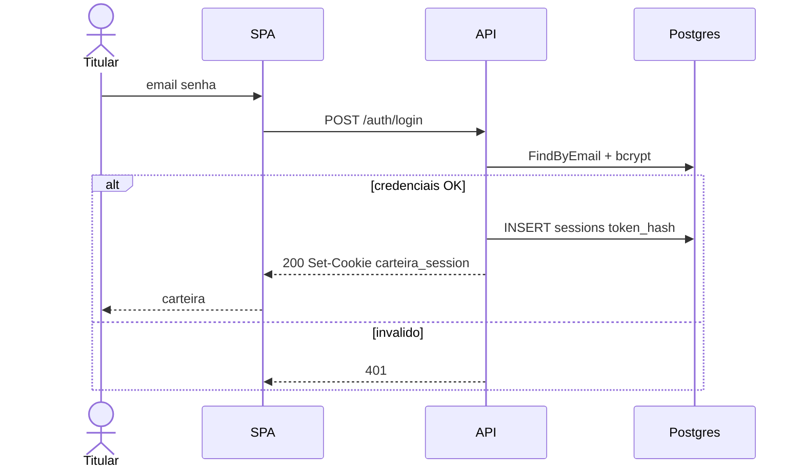
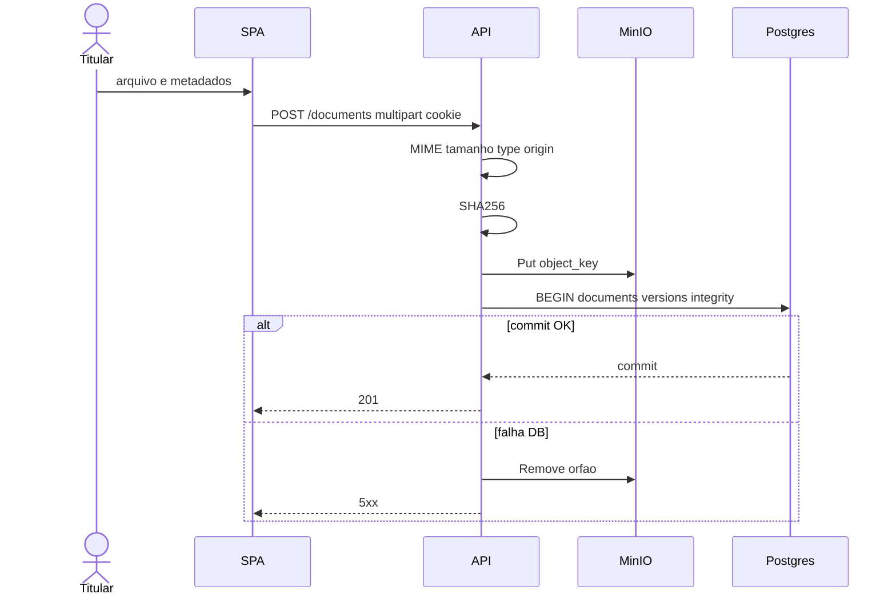
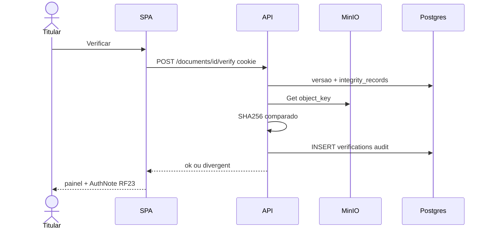
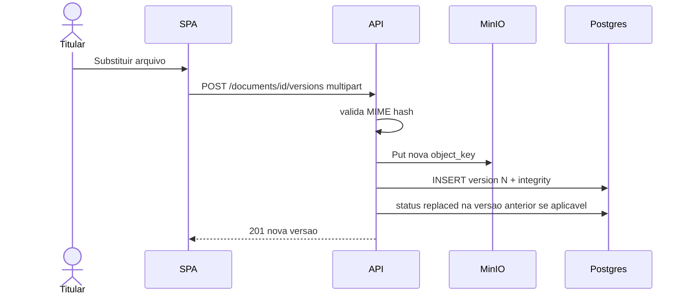
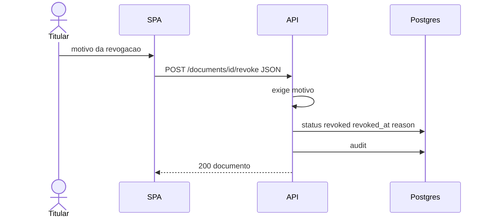
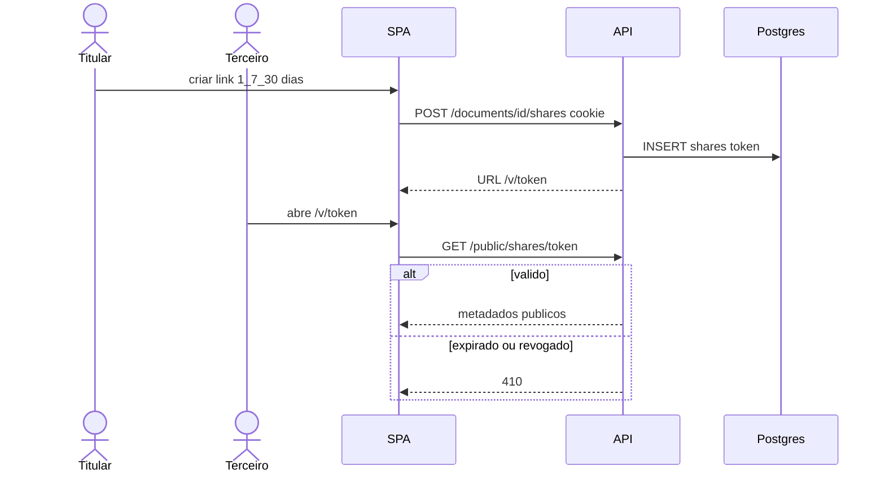
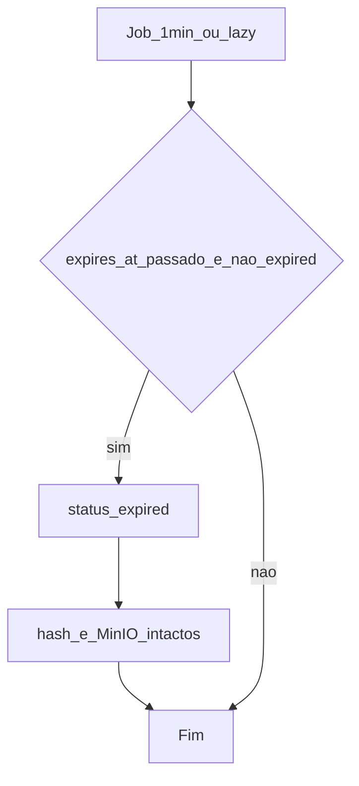
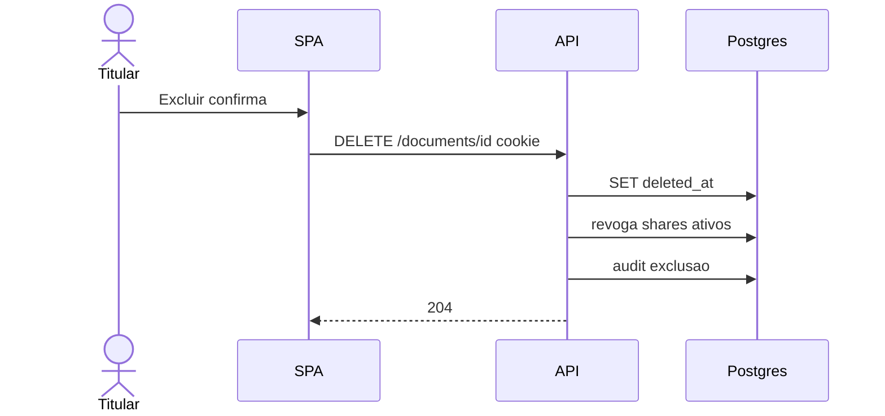

# Fluxos detalhados — Project LAB (Carteira)

**Tipo:** as-built (sequências Mermaid dos fluxos críticos).  
**Fontes:** [ARCHITECTURE.md](./ARCHITECTURE.md), [API.md](./API.md), [CASOS_DE_USO.md](./CASOS_DE_USO.md), [REGRAS_NEGOCIO.md](./REGRAS_NEGOCIO.md), [UML.md](./UML.md).

## Índice

| ID | Fluxo | UC | RF / RN |
|---|---|---|---|
| F1 | Autenticar / sessão | UC01–03 | RF-01/02 · RN-01…04 |
| F2 | Incluir documento (upload + integridade) | UC04 | RF-03/08/09 · RN-05…09 |
| F3 | Verificar integridade | UC07 | RF-10/11/23 · RN-24/25 |
| F4 | Substituir versão | UC09 | RF-14 · RN-10 |
| F5 | Revogar documento | UC11 | RF-13/15 · RN-12/13 |
| F6 | Criar share + validar link | UC14, UC16 | RF-18–20 · RN-19…22 |
| F7 | Expiração automática | UC17 | RF-16 · RN-14 |
| F8 | Exclusão lógica (+ revoga shares) | UC12 | RF-22 · RN-17/18 |

---

## F1 — Autenticar / sessão

**Pré:** conta existente (ou register UC01). **Pós:** cookie HttpOnly. **Exceções:** `401` credenciais; `422` input.

---

## F2 — Incluir documento (upload + integridade)

**Exceções:** `401`; `413`; `415`; `422`.

---

## F3 — Verificar integridade

**Nota:** hash registrado **não** é sobrescrito (RN-24).

---

## F4 — Substituir versão

**Pré:** documento do titular elegível. **Pós:** versão N imutável; hash próprio (RN-10).

---

## F5 — Revogar documento

**Pré:** `active` ou `replaced`. **Exceções:** motivo vazio → `422`; transição inválida → `409`. Hash intacto (RN-13).

---

## F6 — Criar share + validar link

---

## F7 — Expiração automática (Sistema)

Ator: **Sistema** (UC17). Não altera prova de integridade (RN-13/14).

---

## F8 — Exclusão lógica

**Nota:** sem `Remove` no MinIO (RN-17/18).

---

## Rastreabilidade FE

| Fluxo | Páginas |
|---|---|
| F1 | `Login.tsx`, `auth.tsx` |
| F2 | `Upload.tsx` |
| F3 | `DocumentDetail.tsx`, `VerifyIntegrity.tsx` |
| F4–F5, F8 | `DocumentDetail.tsx` |
| F6 | `Share.tsx`, `Verify.tsx` |
| F7 | job backend + lazy list/get |
