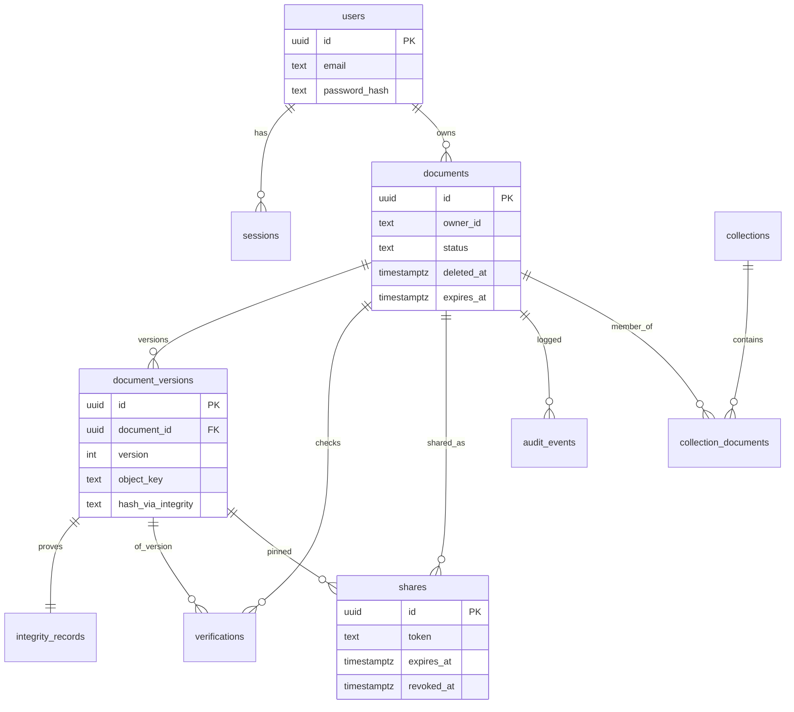

# Glossário de entidades — Project LAB (Carteira)

**Tipo:** as-built (vocabulário alinhado ao schema Postgres + domínio).  
**Fontes:** `backend/internal/db/migrations/`, [API.md](./API.md), [REGRAS_NEGOCIO.md](./REGRAS_NEGOCIO.md), [ATORES.md](./ATORES.md).  
**Irmãos:** [UML.md](./UML.md), [FLUXOS.md](./FLUXOS.md).

## 1. Diagrama ER (simplificado)

`owner_id` em `documents` / `shares` / `audit_events` / `collections` guarda o UUID do usuário como texto (mesmo valor de `users.id`).

---

## 2. Entidades persistidas

### Usuário / Titular — `users`

**Definição:** conta autenticável que possui a carteira.

| Atributos-chave | Papel |
|---|---|
| `id` | UUID; valor usado como `owner_id` nas demais tabelas |
| `email` | único (case-sensitive na constraint atual) |
| `password_hash` | senha; nunca exposta na API |
| `name` | opcional |

**Relacionamentos:** 1:N com `sessions`; lógica 1:N com documentos via `owner_id`.  
**RF / RN:** RF-01/02 · RN-01

### Sessão — `sessions`

**Definição:** credencial de sessão do titular; cookie HttpOnly carrega token cujo SHA-256 está em `token_hash`.

| Atributos-chave | Papel |
|---|---|
| `user_id` | FK → `users` |
| `token_hash` | único |
| `expires_at` | validade da sessão |

**RF / RN:** RF-02 · RN-01

### Documento — `documents`

**Definição:** unidade lógica da carteira (metadados + estado); o arquivo físico fica nas versões/MinIO.

| Atributos-chave | Papel |
|---|---|
| `owner_id` | titular |
| `title`, `type`, `origin`, `tags` | metadados (RF-04/05) |
| `status` | `active` \| `replaced` \| `revoked` \| `expired` |
| `expires_at` | validade opcional (RF-16) |
| `revoked_reason` / `revoked_at` | revogação (RF-15) |
| `deleted_at` | exclusão lógica (RF-22); NULL = visível |

**Relacionamentos:** 1:N versões, verificações, shares; N:N coleções.  
**RF / RN:** RF-03…07, 13…17, 22 · RN-01, RN-07, RN-08, RN-10

### Versão de documento — `document_versions`

**Definição:** snapshot imutável de um arquivo enviado (objeto MinIO + metadados de arquivo).

| Atributos-chave | Papel |
|---|---|
| `document_id` + `version` | sequência única por documento |
| `object_key` | caminho no bucket |
| `file_name`, `size_bytes`, `mime_type` | arquivo |

**Relacionamentos:** 1:1 com `integrity_records`; referenciada por shares e verifications.  
**RF / RN:** RF-08, RF-14 · RN-03, RN-06

### Registro de integridade — `integrity_records`

**Definição:** prova criptográfica da versão (`algorithm` + `hash`).

| Atributos-chave | Papel |
|---|---|
| `version_id` | único (uma prova por versão) |
| `algorithm` | tipicamente `SHA-256` |
| `hash` | hex do conteúdo; **não** sobrescrito em divergência |

**RF / RN:** RF-08/09/10 · RN-03, RN-04

### Verificação — `verifications`

**Definição:** evidência de uma comparação hash recalculado × registrado.

| Atributos-chave | Papel |
|---|---|
| `result` | `ok` \| `divergent` \| `unverifiable` \| `missing_record` |
| `expected_hash` / `computed_hash` | snapshot do compare |
| `context` | ex.: `owner` |

**RF / RN:** RF-10/11 · RN-04

### Evento de auditoria — `audit_events`

**Definição:** trilha de ações do titular **sem** bytes do arquivo.

| Atributos-chave | Papel |
|---|---|
| `owner_id`, `actor`, `action` | quem / o quê |
| `document_id`, `document_title`, `context` | alvo e detalhe textual |

**RF / RN:** RF-21 · UC15

### Compartilhamento (share) — `shares`

**Definição:** link público opaco amarrado a uma **versão** específica, com prazo.

| Atributos-chave | Papel |
|---|---|
| `token` | único; usado em `/public/shares/{token}` |
| `expires_at` | prazo do link |
| `revoked_at` | revogação explícita ou via exclusão do doc |

**RF / RN:** RF-18/19/20 · RN-09

### Coleção — `collections`

**Definição:** agrupamento nomeado de documentos do mesmo titular.

| Atributos-chave | Papel |
|---|---|
| `owner_id`, `name` | dono e rótulo |

**RF / RN:** RF-06 · UC13

### Associação coleção–documento — `collection_documents`

**Definição:** junction N:N; PK composta `(collection_id, document_id)`.

**RF / RN:** RF-06

---

## 3. Conceitos (sem tabela própria)

| Termo | Definição | RF / campo |
|---|---|---|
| **Autenticidade** | Proveniência/órgão emissor — **não** verificada no MVP. | RF-23 |
| **Cookie `carteira_session`** | Sessão HttpOnly do titular; valor cru no browser, hash no servidor. | RF-02 · `sessions` |
| **Exclusão lógica** | Documento com `deleted_at` preenchido; some da listagem; bytes/hash permanecem. | RF-22 |
| **Hash SHA-256** | Digest dos bytes exatos do arquivo na inclusão/versão. | RF-08/09 |
| **Integridade** | Arquivo atual bate com o hash registrado. | RF-10 |
| **`owner_id`** | UUID do titular (texto) em documentos/shares/coleções/auditoria. | RF-02 |
| **Objeto MinIO / `object_key`** | Bytes no storage S3-compatível. | RF-03 |
| **Recibo** | PDF com hash, metadados e QR (`GET …/receipt`). | RF-12 |
| **Status** | `active`, `replaced`, `revoked`, `expired`. | RF-13 |
| **Titular** | Ator dono da carteira (usuário autenticado). | [ATORES.md](./ATORES.md) |
| **Terceiro verificador** | Acessa só via token de share; sem conta. | RF-20 |
| **Token de share** | Segredo opaco do link público (`shares.token`). | RF-18/19 |

---

## 4. Índice rápido

| Nome PT | Tabela |
|---|---|
| Usuário / Titular | `users` |
| Sessão | `sessions` |
| Documento | `documents` |
| Versão | `document_versions` |
| Registro de integridade | `integrity_records` |
| Verificação | `verifications` |
| Evento de auditoria | `audit_events` |
| Compartilhamento | `shares` |
| Coleção | `collections` |
| Associação coleção–doc | `collection_documents` |
