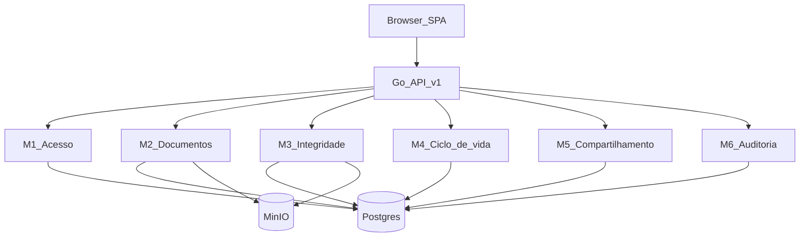

# Módulos do sistema — Project LAB (Carteira)

**Tipo:** as-built (mapa do monolito Go + SPA React em produção).  
**Alinhado a:** [REQUISITOS.md](./REQUISITOS.md) (módulos 1–6), [ARCHITECTURE.md](./ARCHITECTURE.md), [REGRAS_NEGOCIO.md](./REGRAS_NEGOCIO.md).

## 1. Visão

Um binário Go serve API e SPA. Domínios em `backend/internal/` seguem `handler → service → repository`. O frontend consome `/api/v1` com cookie de sessão.

Na prática, **Integridade** e **Ciclo de vida** vivem no pacote `internal/documents` (mesmo bounded context de arquivo); são módulos lógicos separados para a documentação acadêmica, espelhando a divisão de RFs.

---

## 2. Catálogo de módulos

### M1 — Acesso

| | |
|---|---|
| **Responsabilidade** | Cadastro, login, logout, cookie de sessão, middleware que injeta o titular |
| **Pacote** | `backend/internal/auth` |
| **FE** | `Login.tsx`, `auth.tsx` (guard) |
| **RFs** | RF-01, RF-02 |
| **RNs** | RN-01 … RN-04 |
| **Não faz** | Papéis/admin; OAuth Gov.br; JWT de terceiros |

### M2 — Documentos

| | |
|---|---|
| **Responsabilidade** | Upload, metadados, listagem/busca/download, coleções N:N, nova versão, PATCH metadados, soft-delete |
| **Pacote** | `backend/internal/documents`, `backend/internal/collections` |
| **FE** | `Upload.tsx`, `Wallet.tsx`, `DocumentDetail.tsx`, `Collections.tsx` |
| **RFs** | RF-03…07, RF-14, RF-17, RF-22 (e parte de RF-05) |
| **RNs** | RN-05…RN-10, RN-16…RN-18 |
| **Não faz** | Prova de autenticidade do emissor |

### M3 — Integridade

| | |
|---|---|
| **Responsabilidade** | Hash SHA-256 na inclusão, registro por versão, verify + evidências, recibo PDF, distinção integridade×autenticidade na UX |
| **Pacote** | `internal/documents` (hash, verify, receipt); UI `AuthNote` |
| **FE** | `VerifyIntegrity.tsx`, `Receipt.tsx`, painéis em `DocumentDetail.tsx` |
| **RFs** | RF-08…12, RF-23 |
| **RNs** | RN-08, RN-10, RN-24, RN-25 |
| **Não faz** | Assinatura digital; carimbo de tempo externo; PKI |

### M3b — Assistente (OCR + IA + RAG)

| | |
|---|---|
| **Responsabilidade** | OCR/visão, coerência assistida vs metadados, chat FAB com RAG lexical; disclaimer RF-23 |
| **Pacote** | `internal/assistant` (Groq, FTS, handlers) |
| **FE** | `AssistantFab.tsx`, painel Coerência em `DocumentDetail.tsx` |
| **Docs** | [ASSISTENTE.md](./ASSISTENTE.md) |
| **Não faz** | Autenticidade de emissor; DocTR; chat público |

### M4 — Ciclo de vida

| | |
|---|---|
| **Responsabilidade** | Estados do documento, revogação com motivo, validade/`expires_at`, job e lazy de expiração |
| **Pacote** | `internal/documents` (`Revoke`, `ExpireDue`, transições de status) |
| **FE** | `DocumentDetail.tsx`, `StatusBadge` |
| **RFs** | RF-13…16 |
| **RNs** | RN-11 … RN-15 |
| **Não faz** | Exclusão física imediata; alteração de hash ao expirar |

### M5 — Compartilhamento

| | |
|---|---|
| **Responsabilidade** | Criar/listar/revogar links; token com prazo; endpoint público para terceiros |
| **Pacote** | `backend/internal/shares` |
| **FE** | `Share.tsx`, `Verify.tsx` (`/v/:token`) |
| **RFs** | RF-18, RF-19, RF-20 |
| **RNs** | RN-19 … RN-22 |
| **Não faz** | ACL granular por campo; autenticação do terceiro |

### M6 — Auditoria

| | |
|---|---|
| **Responsabilidade** | Persistir e listar trilha de ações do titular (sem bytes do arquivo) |
| **Pacote** | `backend/internal/audit` |
| **FE** | `Audit.tsx` |
| **RFs** | RF-21 |
| **RNs** | RN-23 |
| **Não faz** | SIEM externo; auditoria cross-tenant |

---

## 3. Dependências entre módulos

| De | Para | Motivo |
|---|---|---|
| M2–M6 | M1 | Rotas privadas exigem sessão |
| M3, M4 | M2 | Operam sobre `documents` / versões |
| M5 | M2 | Share amarrado a documento/versão |
| M2 (soft-delete) | M5 | Revoga shares ativos (RN-18) |
| M2–M5 | M6 | Emitem eventos de auditoria |
| M3 | MinIO | Relê objeto para verify / receipt |
| M2 | MinIO + Postgres | Put + commit atômico |

Infra transversal (não é “módulo de negócio”): `internal/config`, `internal/db`, `internal/storage`, `internal/httpx`, `cmd/server`.

---

## 4. Rastreabilidade RF → módulo

| RF | Módulo |
|---|---|
| 01–02 | M1 |
| 03–07, 14, 17, 22 | M2 |
| 08–12, 23 | M3 |
| 13–16 | M4 |
| 18–20 | M5 |
| 21 | M6 |

Detalhe de endpoints: [API.md](./API.md). Mapa arquivo a arquivo: [CONTRIBUTING.md](./CONTRIBUTING.md).
