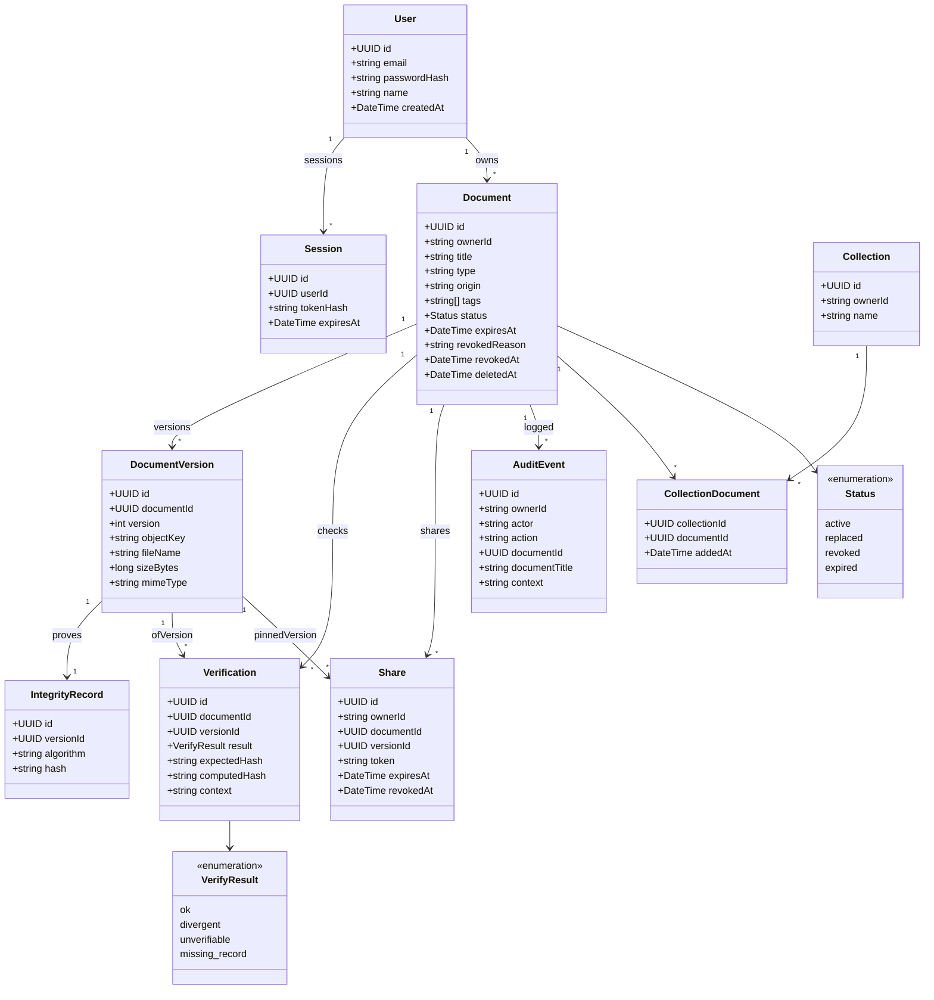
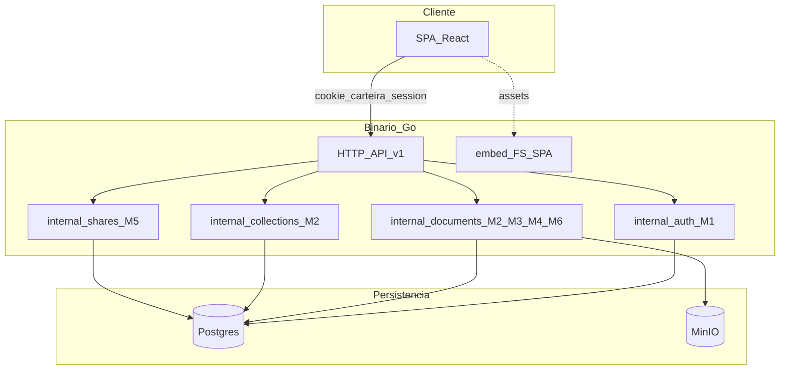
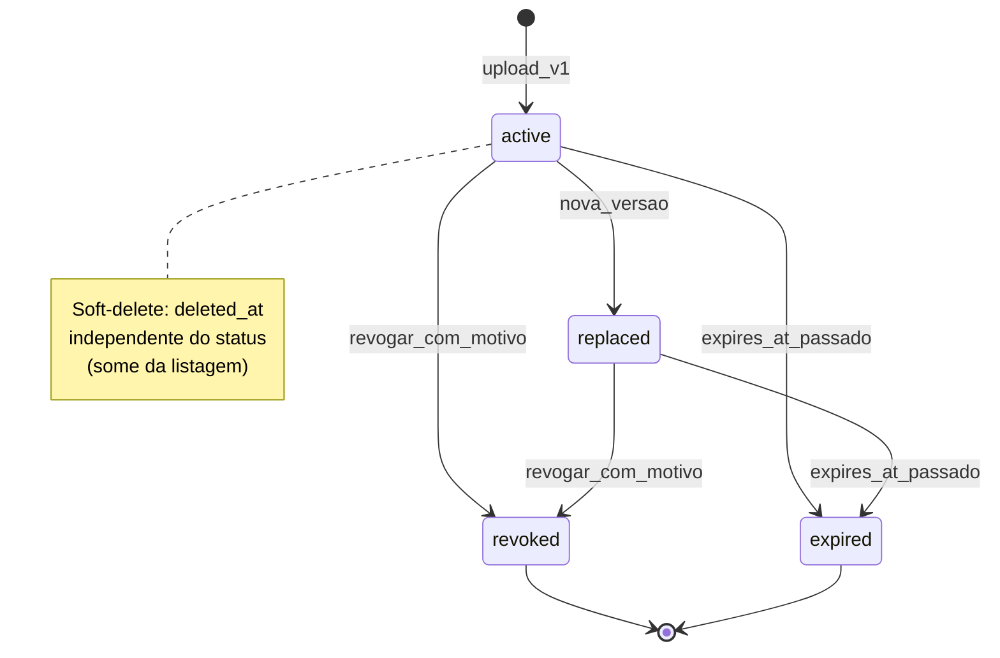
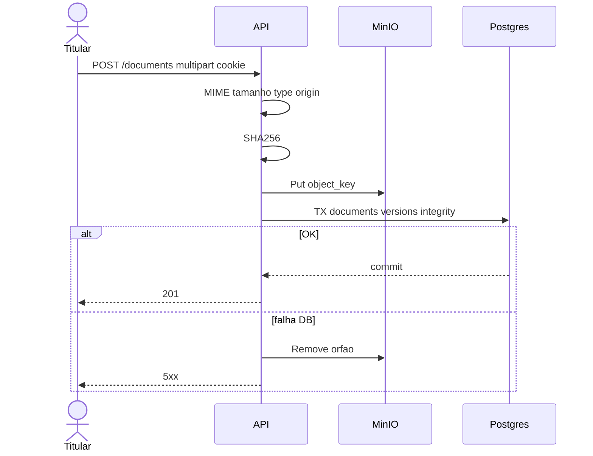

# Modelagem UML — Project LAB (Carteira)

**Tipo:** as-built (estrutura do MVP em Mermaid).  
**Fontes:** [GLOSSARIO.md](./GLOSSARIO.md), [MODULOS.md](./MODULOS.md), [ATORES.md](./ATORES.md), [CASOS_DE_USO.md](./CASOS_DE_USO.md).  
**Casos de uso:** diagrama e catálogo UC01–UC17 em [CASOS_DE_USO.md](./CASOS_DE_USO.md) (não duplicados aqui).  
**Demais sequências:** [FLUXOS.md](./FLUXOS.md).

## 1. Introdução

Modelagem estrutural do domínio persistido e da implantação lógica (SPA + API Go + Postgres + MinIO). Classes espelham as entidades do glossário; componentes espelham os módulos M1–M6. Inclui diagrama de estados do documento e uma sequência de referência (upload).

---

## 2. Diagrama de classes (domínio)

Notas:

- `ownerId` nas entidades de carteira = `User.id` (texto no schema).
- `CollectionDocument` é a associação N:N explícita (tabela `collection_documents`).
- Bytes do arquivo **não** são atributos de classe de domínio; vivem no MinIO via `objectKey` (RN-03/06).

---

## 3. Diagrama de componentes

| Componente | Módulo lógico | Pacote / superfície |
|---|---|---|
| `internal/auth` | M1 Acesso | register/login/logout/me + middleware |
| `internal/documents` | M2+M3+M4+M6 | upload, verify, versions, ciclo de vida, `GET /audit` |
| `internal/collections` | M2 (coleções) | CRUD + membership |
| `internal/shares` | M5 | create/list/revoke + público |
| SPA React | UI | páginas por UC ([CASOS_DE_USO.md](./CASOS_DE_USO.md) §4) |

M6 (auditoria) é módulo lógico; no código as-built os eventos e `GET /audit` ficam em `internal/documents` (ou pacote `internal/audit` conforme versão do código).

---

## 4. Diagrama de estados — Document

Regras: `active`/`replaced` → `revoked` (RN-12); expiração não altera hash (RN-13); soft-delete revoga shares (RN-18).

---

## 5. Sequência de referência — upload + hash

Detalhe e demais fluxos: [FLUXOS.md](./FLUXOS.md) (F0–F7).

---

## 6. Rastreabilidade

| Artefato UML | Doc |
|---|---|
| Classes | [GLOSSARIO.md](./GLOSSARIO.md) |
| Estados | §4 + RF-13/15/16 |
| Sequência upload | §5 + [FLUXOS.md](./FLUXOS.md) F1 |
| Componentes / módulos | [MODULOS.md](./MODULOS.md) |
| Casos de uso | [CASOS_DE_USO.md](./CASOS_DE_USO.md) |
| Atores | [ATORES.md](./ATORES.md) |
| Implantação física | [ARCHITECTURE.md](./ARCHITECTURE.md) |
